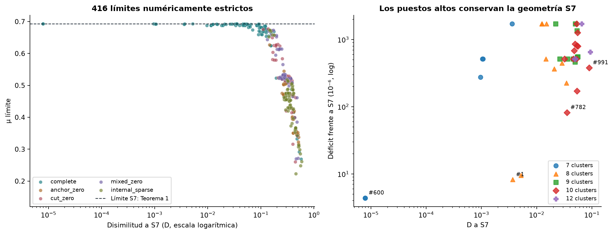
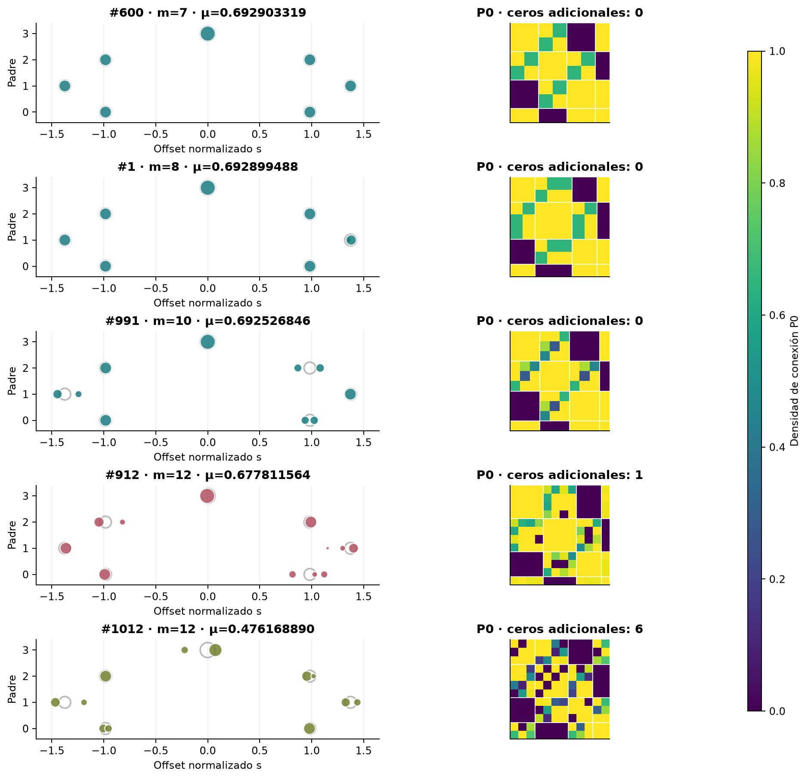
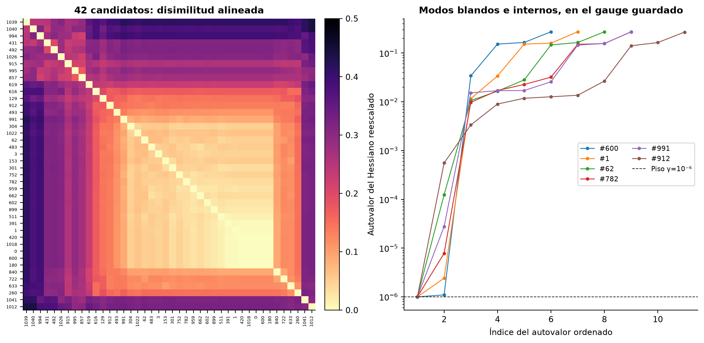
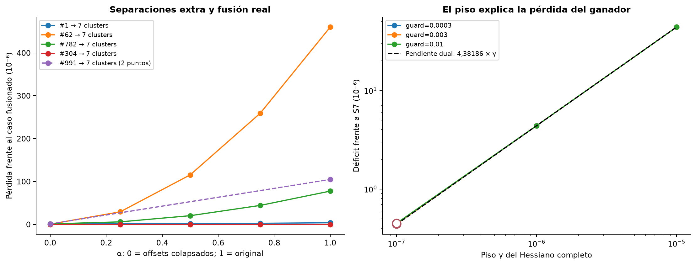
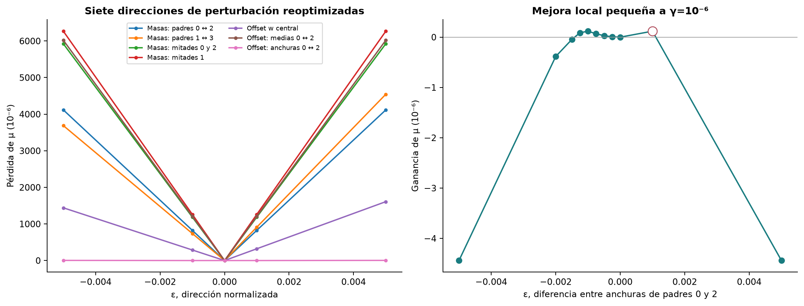

# ¿Los mejores candidatos son S7 o nuevas estructuras?

Informe de investigación — 26 de octubre de 2026  
Proyecto: `kuramoto-template` (proyecto registrado como `sync-template`); rama `asymptotic_search`.

## Resultado principal

El ganador original **#600 es S7 en su geometría**, con las mismas masas y offsets normalizados que la referencia. Su P0 es una perturbación de magnitud máxima 1.677e-05. Los 20 mejores conservan el soporte completo entre padres permitidos, provienen de reinicios y tienen masas agregadas en apenas tres patrones S7. Los casos de 8–12 clusters incluyen refinamientos próximos y algunas densidades de conexión heterogéneas; **no son todos copias exactas de S7**.

Las seis fusiones comprobadas conservan o mejoran la densidad al reducir a siete clusters. El caso #991 es la excepción visual más interesante: tiene conexiones cruzadas heterogéneas y no se identifica con S7 sólo permutando o fusionando gemelos exactos. Sin embargo, su fusión reoptimizada mejora μ de 0,692526846 a 0,692631716. No se observa una ventaja de sus grados de libertad extra.

Hay soportes realmente distintos y soluciones con masas desiguales, pero ninguno domina S7. El mejor límite estricto con una prohibición adicional de arista es #912, de 12 clusters: **μ₀ = 0,677811564386**. Es 0,015096142 inferior a la referencia. La conclusión es evidencia favorable a S7 dentro de este experimento; **no es una prueba de optimalidad, ni evidencia suficiente de una cuenca de atracción universal**.

La mejor μ₀ del barrido sigue siendo **0,6929033189148635**, inferior a **0,6929077063695864** por **4,3874547×10⁻⁶**. Al reducir el piso γ en las pruebas nuevas, se obtiene una solución estricta numérica con μ₀ = **0.6929072637491324**, todavía inferior a la referencia por **4.426e-07**, sin demostrar una familia superior.

**Aclaración sobre los dos valores del paper.** El número 0,6929050246493944 corresponde al ejemplo concreto certificado de la Proposición 1. El Teorema 1 demuestra la cota mayor 0,6929077063695864 mediante estados que se aproximan a ese límite. Ambos aparecen en la [sección V del paper](https://arxiv.org/html/2610.21271v1). Por tanto, nuestro número límite sí supera el valor del ejemplo concreto, pero sigue por debajo de la cota demostrada por el teorema. Además, todavía no se ha obtenido un levantamiento finito de ese candidato nuevo que supere el ejemplo de la proposición.

| Resultado | μ o μ₀ | Qué está establecido |
| --- | --- | --- |
| Paper, Proposición 1 | 0,6929050246493944 | Ejemplo concreto certificado y realización en grafos |
| Paper, Teorema 1 | 0,6929077063695864 | Cota inferior demostrada por una familia que se aproxima al límite |
| Nuevo candidato de este análisis | 0,6929072637491324 | Resultado numérico del modelo límite; sin lift finito de ese candidato ensayado |
| Mejor lift finito guardado del proyecto | 0,6926591963503084 | Estricto numérico, sin certificado riguroso |

La diferencia del candidato nuevo frente al ejemplo concreto del paper es +2,23910×10⁻⁶, y frente a su cota teórica es −4,42620×10⁻⁷. Estas comparaciones numéricas no convierten al candidato límite en una construcción finita certificada. Conseguir un ejemplo finito certificado por encima de la Proposición 1 sería una mejora del ejemplo explícito, aunque aún podría quedar por debajo del Teorema 1.

## Datos localizados, alcance y trazabilidad

La carpeta accesible es `C:\Users\lucas\Desktop\proyectos\kuramoto-template\runs\joint-research-final`. Existen **1.048 snapshots inmutables**, `sweep/checkpoint.json`, `sweep/result.json`, `sweep/trace.jsonl`, `sweep/top-limit.json`, `sweep/top-finite.json` y `finalist-refinement.json`. No hay que suponer un `top-candidate.json` en la raíz. Los archivos están ignorados por `/runs/` en `.gitignore`, pero están presentes localmente. No fue necesario recuperar propuestas ni repetir el barrido.

El checkpoint termina en `phase=done`, cursor 1.050 y dos aciertos de caché exacta. Sus estados coinciden con el reporte:

| m | Estrictos numéricos | Inciertos | Inviables condicionales | Inestables |
| --- | --- | --- | --- | --- |
| 7 | 44 | 35 | 130 | 0 |
| 8 | 98 | 14 | 96 | 1 |
| 9 | 104 | 22 | 84 | 0 |
| 10 | 94 | 27 | 89 | 0 |
| 12 | 76 | 60 | 74 | 0 |

Los 473 casos inviables son **inviabilidad numérica condicional** de un problema interno restringido a una geometría, soporte, guard, pisos y límites de R. No excluyen otras geometrías, correcciones, soportes o clases de modelos. Los 158 inciertos conservan su etiqueta; no se incorporan al ranking estricto.

Se analizan invariantes de todos los resultados con candidato disponible. Se seleccionan **42 testigos estrictos**: los 20 mejores, 17 mejores adicionales por estrato (m, familia) de 8–12 clusters, cuatro mejores descendientes de masas/offsets de esos tamaños y el mejor descendiente topológico. Se reensamblan y validan los 42; todos reproducen su estado y μ. La máxima violación primal en esa muestra es 4.466e-11, dentro de la tolerancia configurada 10⁻⁹. Las 42 reproducciones con solver reproducen μ exactamente en este entorno.

Se recuperaron duales repitiendo sólo esos problemas internos, sin modificar la implementación: los snapshots guardaban residuos primal/dual del solver, pero no sus multiplicadores por restricción. Los datos, matrices, duales y nuevos resultados están en los archivos JSON de evidencia y en [experimentos.csv](experimentos.csv).

El hash de fuente actual coincide con el guardado: `ed53a17af33b100a06e42fd4b381d0cf3008c112738760e2aeb2dbfad30476e6`. HEAD: `4ba59ec75ca8759511978dace38ec968455fdbeb`. Se verificó el contenido de **103 archivos** de fuente/documentación/ejemplos: ninguno cambió. El checkout ya tenía cambios y archivos sin seguimiento de la implementación conjunta; se conservaron. No se cambió de rama ni se modificó `repair_sdp`. Los **445 tests** son el resultado previo informado; no se volvió a ejecutar esa suite porque este trabajo no cambia la implementación.

## Qué significa aquí «parecido a S7»

La comparación usa masas x, offsets s normalizados con ∑x s = 0 y ∑x s² = 1, etiquetas de los cuatro padres y P0. Se minimiza sobre las cuatro rotaciones cíclicas de padres; también se permite reflexión global de fase (g,s) ↦ (−g,−s), que es una simetría adicional indicada explícitamente. Las permutaciones de clusters se eliminan mediante transporte monótono de las medidas de offsets dentro de cada padre. No se comparan matrices por su orden de filas.

Se reportan por separado:

- **Δ masas L1**: diferencia de masas totales de los cuatro padres después del alineamiento.
- **W₂ offsets**: distancia cuadrática de transporte entre distribuciones condicionales de offsets, ponderada por la masa del padre candidato.
- **RMS P0**: error cuadrático medio de densidades bajo ese mismo acoplamiento de masas. Incluye las diagonales: un refinamiento exacto debe conectar a sus clones con densidad uno.
- **Desacuerdo de máscara**: masa de pares cuyo permiso de conexión cambia; además se cuenta el número de ceros adicionales respecto de los padres opuestos prohibidos.

La disimilitud descriptiva es D² = Δ masas L2² + W₂² + RMS P0². Para clustering entre dos candidatos se promedian las dos direcciones del transporte, pues la ponderación condicional es asimétrica. D **no se presenta como una distancia métrica certificada ni como criterio de equivalencia matemática**. En los candidatos originales seleccionados no hay empates ambiguos de offsets dentro de un padre. Se comprobaron 126 transformaciones aleatorias de permutación, rotación/reflexión y traslación de offsets: diferencia máxima de los invariantes 1.51e-11.

La fusión exploratoria agrupa sólo offsets del mismo padre que caben en un intervalo de diámetro ε; no usa encadenamiento simple. Se repite con ε = 0,02 / 0,05 / 0,1 / 0,2 y mide la dispersión de filas de P0 dentro de las celdas. Tener offsets próximos no basta para ser gemelos: se necesita también conexión interna completa y filas compatibles. La posterior fusión con reoptimización es una prueba numérica de redundancia para la densidad, no una identidad exacta entre testigos.

## Los 20 mejores

Los IDs son índices de snapshot, no índices de propuesta: por ejemplo #600 corresponde al archivo `sweep/joint-results/000600.json`. Todos los siguientes tienen familia de origen `complete`, máscara completa permitida y operación `restart`.

| ID | m | μ₀ | guard | Δμ ref. ×10⁶ | W₂ offsets | RMS P0 | Fusión ε=0,05 |
| --- | --- | --- | --- | --- | --- | --- | --- |
| 600 | 7 | 0.6929033189149 | 0.001 | 4.387 | 0.00000 | 0.00001 | 7 |
| 180 | 7 | 0.6929033189140 | 0.01 | 4.387 | 0.00000 | 0.00001 | 7 |
| 1 | 8 | 0.6928994875997 | 0.01 | 8.219 | 0.00365 | 0.00001 | 7 |
| 391 | 8 | 0.6928981677412 | 0.003 | 9.539 | 0.00519 | 0.00002 | 7 |
| 782 | 10 | 0.6928256339339 | 0.001 | 82.072 | 0.03533 | 0.00017 | 9 |
| 153 | 10 | 0.6927367783588 | 0.001 | 170.928 | 0.05351 | 0.00031 | 10 |
| 301 | 8 | 0.6926816508448 | 0.003 | 226.056 | 0.03445 | 0.00041 | 8 |
| 0 | 7 | 0.6926317157596 | 0.01 | 275.991 | 0.00020 | 0.00087 | 7 |
| 899 | 8 | 0.6925423022802 | 0.01 | 365.404 | 0.02076 | 0.00097 | 8 |
| 991 | 10 | 0.6925268459698 | 0.01 | 380.860 | 0.05437 | 0.07119 | 10 |
| 959 | 8 | 0.6924629076145 | 0.001 | 444.799 | 0.02863 | 0.00108 | 8 |
| 62 | 9 | 0.6924430280827 | 0.001 | 464.678 | 0.04966 | 0.00083 | 9 |
| 420 | 7 | 0.6923949526114 | 0.001 | 512.754 | 0.00020 | 0.00099 | 7 |
| 1018 | 7 | 0.6923949526113 | 0.003 | 512.754 | 0.00020 | 0.00096 | 7 |
| 3 | 10 | 0.6923949521474 | 0.01 | 512.754 | 0.04603 | 0.00172 | 10 |
| 602 | 9 | 0.6923949519763 | 0.001 | 512.754 | 0.02234 | 0.01388 | 9 |
| 752 | 9 | 0.6923949519079 | 0.003 | 512.754 | 0.04573 | 0.00106 | 9 |
| 511 | 8 | 0.6923949519051 | 0.001 | 512.754 | 0.01458 | 0.00101 | 8 |
| 662 | 9 | 0.6923949517630 | 0.003 | 512.755 | 0.03608 | 0.00090 | 9 |
| 483 | 10 | 0.6923949517324 | 0.003 | 512.755 | 0.05215 | 0.00088 | 10 |

El caso #600 tiene x = (a,a,a,a,a,a,b), a = 0,13070922936304136 y b = 0,21574462382175186; s = (−u,u,−v,v,−u,u,0), u = 0,9834417763505504 y v = 1,3751251319532154. Por tanto v/u = w* = 1,3982781340204612. La discrepancia de x y s con S7 normalizado es de redondeo, no una deformación estructural.

Sus cuatro densidades cruzadas son q ≈ 0.6505523986815, con dispersión 7.99e-15; las cuatro conexiones al ancla son ≈ 0.9999898348621. Las otras siete aristas permitidas están en el techo buffered 1−10⁻⁸. Los seis clusters divididos tienen grado mínimo activo; el ancla tiene grado 0,738576226565.

Los casos #600 y #180 repiten la misma geometría con guard distinto. #1 y #391 se reducen a siete celdas a ε=0,05, con errores RMS P0 de 1,47×10⁻⁵ y 1,71×10⁻⁵. #782 necesita una fusión menos estricta (ε=0,2) para reducir a siete celdas; sus offsets extra tienen un efecto pequeño pero real. No debe confundirse estar cerca de S7 con ser idéntico a él.

**#991 merece conservarse como representante de una deformación heterogénea**: RMS P0 ≈ 0,07119 y dispersión de filas en la proyección a siete celdas ≈ 0.07118. Sus conexiones cruzadas incluyen valores ≈ 0,2486, 0,2857, 0,4564, 0,8519 y 0,8725. Estas diferencias no desaparecen por relabeling ni por fusionar gemelos exactos. Aun así, el resultado de fusión más abajo muestra que no mejora el objetivo frente a un S7 reajustado.

## Muestra diversa de 8–12 clusters y descendientes

| ID | m | Origen | μ₀ | Ceros extra | Δ masas L1 | W₂ offsets | RMS P0 |
| --- | --- | --- | --- | --- | --- | --- | --- |
| 994 | 8 | anchor_zero | 0.4690199297 | 1 | 0.0122 | 0.1179 | 0.3747 |
| 431 | 8 | cut_zero | 0.5303075909 | 1 | 0.0134 | 0.1310 | 0.2849 |
| 616 | 8 | mixed_zero | 0.6730754322 | 0 | 0.0058 | 0.1700 | 0.0302 |
| 1039 | 8 | internal_sparse | 0.4753524601 | 2 | 0.0028 | 0.1513 | 0.3853 |
| 995 | 9 | anchor_zero | 0.4755157852 | 1 | 0.0077 | 0.1356 | 0.2603 |
| 492 | 9 | cut_zero | 0.5291460804 | 1 | 0.0097 | 0.1864 | 0.2572 |
| 915 | 9 | mixed_zero | 0.5334825582 | 1 | 0.0140 | 0.1413 | 0.2182 |
| 1040 | 9 | internal_sparse | 0.5059336353 | 2 | 0.0099 | 0.1127 | 0.3611 |
| 1026 | 10 | anchor_zero | 0.5075205566 | 2 | 0.0053 | 0.1548 | 0.2670 |
| 493 | 10 | cut_zero | 0.6758729747 | 1 | 0.0064 | 0.0891 | 0.0642 |
| 857 | 10 | mixed_zero | 0.5351908900 | 1 | 0.0054 | 0.1349 | 0.2355 |
| 1041 | 10 | internal_sparse | 0.4887191369 | 3 | 0.0033 | 0.1254 | 0.2940 |
| 304 | 12 | complete | 0.6923949517 | 0 | 0.0006 | 0.0434 | 0.0257 |
| 129 | 12 | anchor_zero | 0.6268102545 | 1 | 0.0077 | 0.1018 | 0.1048 |
| 912 | 12 | cut_zero | 0.6778115644 | 1 | 0.0049 | 0.1058 | 0.0859 |
| 619 | 12 | mixed_zero | 0.6148205417 | 3 | 0.0036 | 0.1339 | 0.1874 |
| 1012 | 12 | internal_sparse | 0.4761688896 | 6 | 0.0040 | 0.1356 | 0.2957 |
| 840 | 8 | complete | 0.6879484120 | 0 | 0.0034 | 0.0902 | 0.0134 |
| 722 | 9 | complete | 0.6862551768 | 0 | 0.0043 | 0.1200 | 0.0162 |
| 633 | 10 | complete | 0.6842961028 | 0 | 0.0025 | 0.1193 | 0.0184 |
| 1022 | 12 | complete | 0.6834138872 | 0 | 0.0045 | 0.0551 | 0.0290 |
| 260 | 7 | internal_sparse | 0.6730782872 | 0 | 0.0053 | 0.1441 | 0.0305 |

«Origen» es una etiqueta de generación y no un invariante de soporte. Por ejemplo #616 procede de `mixed_zero` pero sus mutaciones reabrieron la máscara completa. Por eso la columna «ceros extra» es más informativa para juzgar novedades topológicas.

| Familia de origen | Límites estrictos | Mejor μ₀ |
| --- | --- | --- |
| complete | 112 | 0.692903318915 |
| anchor_zero | 53 | 0.626810254535 |
| cut_zero | 97 | 0.677811564386 |
| mixed_zero | 63 | 0.673075432204 |
| internal_sparse | 91 | 0.673078287172 |
| nonuniform_anchor | 0 | — |

Los **41 límites estrictos con μ₀ > 0,69** y los **64 con μ₀ > 0,68** provienen de `complete`; el mejor soporte con ceros adicionales es #912. La familia con anclas fijadas no uniformes no tiene límites estrictos en esta muestra; esto no demuestra que esa familia sea inviable en general.

El clustering jerárquico de enlace promedio produce 24 / 20 / 14 / 12 / 4 grupos al cortar D en 0,05 / 0,1 / 0,15 / 0,2 / 0,3. A 0,15 hay un grupo grande con 29 candidatos y 13 grupos unitarios. Esta sensibilidad al umbral impide llamar a esos grupos «14 familias matemáticas». Las máscaras distintas y las dispersiones de filas son evidencia estructural más directa.

## Fusión, capacidad de masas y separación de clones

Se asignó cada cluster al átomo S7 más próximo del mismo padre. Para cada celda se sumaron masas y se promediaron offsets con esas masas; después se normalizó el gauge y se resolvió de nuevo el problema de siete clusters con el mismo guard y pisos, soporte completo y árbol de reparación recalculado.

| ID original | m | μ₀ original | μ₀ tras fusión a 7 | Ganancia ×10⁶ |
| --- | --- | --- | --- | --- |
| 1 | 8 | 0.6928994875997 | 0.6929033189141 | 3.831 |
| 62 | 9 | 0.6924430280827 | 0.6929033189150 | 460.291 |
| 782 | 10 | 0.6928256339339 | 0.6929033189141 | 77.685 |
| 153 | 10 | 0.6927367783588 | 0.6929033189142 | 166.541 |
| 991 | 10 | 0.6925268459698 | 0.6926317157597 | 104.870 |
| 304 | 12 | 0.6923949516765 | 0.6923949526113 | 0.001 |

En cuatro representantes (#1, #62, #782, #304) también se recorrió s(α) = normalize((1−α)s_S7 + αs_original) para α = 0, 1/4, 1/2, 3/4, 1, manteniendo las masas y el número original de clusters. Al colapsar offsets sin fusionar filas todavía cambia la normalización del piso euclídeo del bloque hard: por eso μ en α=0 puede diferir en ≈10⁻⁶ del problema realmente fusionado. Las comparaciones de márgenes entre distintos tamaños deben interpretarse con esa diferencia de gauge, no como mejoras físicas de estabilidad.

Una cota elemental explica las mesetas del ranking. Sea M_g la masa total del padre g. De F0=0, cada cluster recibe la misma contribución de densidad desde los dos padres vecinos. Como cada contribución está acotada por la masa del vecino, y la contribución interna por M_g,

    μ₀ ≤ min_g [ M_g + 2 min(M_(g−1), M_(g+1)) ].

Es una desigualdad para este modelo con enlaces opuestos nulos y equilibrio de orden cero; no utiliza estabilidad. Para las masas del ganador, da exactamente la referencia 0,69290770637. Para el patrón S7 con t=0,003 da 0,692394952612. Los ocho últimos puestos de la tabla top20 casi saturan esta última cota: esa meseta refleja sobre todo sus masas iniciales. En #304, fusionar cambia μ en menos de 10⁻⁹; ese no es un indicio de una nueva densidad óptima de 12 clusters.

## Restricciones activas, duales y modos débiles

| Magnitud, ganador #600 | Valor / observación |
| --- | --- |
| Grados mínimos activos | 6 de 7; multiplicadores positivos y suma ≈ 1 |
| Grado del cluster ancla | 0.738576226565; multiplicador ≈ 8,5×10⁻¹⁴ |
| Dos autovalores completos menores | 9,9999989×10⁻⁷ y 1,0970523×10⁻⁶ |
| Traza del dual PSD | 4.381863597 |
| Autovalores duales significativos | 4,38186353; siguiente ≈ 6,94×10⁻⁸ |
| Complementariedad tr(Y(H−γI)) | -4.405e-13 |
| Piso hard / mínimo observado | 10⁻⁶ / 0,0341698; multiplicador despreciable |
| Piso restoring / mínimo observado | 10⁻⁴ / 0,215745; multiplicador despreciable |
| Límite abs(R) / máximo observado | 30 / 20,1015; no activo |
| P0 cerca del techo buffered | 7 aristas (3 internas y 4 vecinas no cruzadas), a 1−10⁻⁸ |
| Norma del dual del buffer superior | 0.257668 |

El mínimo completo está aproximadamente 10⁷ veces por encima de la estimación de redondeo matricial (9,33×10⁻¹⁴), aunque está en el piso impuesto de 10⁻⁶. La menor dirección, proyectada a los cuatro padres y renormalizada, es aproximadamente (0,707107, 0, −0,707107, 0). El subespacio de los dos modos efectivos menores coincide casi con el plano de dipolos (1,0,−1,0) y (0,1,0,−1): los valores singulares del solapamiento para #600 son 1 y 0,9999999982. Se usa el subespacio porque dos modos próximos pueden rotar y cambiar de signo entre soluciones.

Las normas de duales de las cotas guard contienen contribuciones artificiales de constantes exactas (diagonales y enlaces prohibidos); no se interpretan como aristas físicamente limitantes. Las ecuaciones también tienen dependencias, por lo que sus multiplicadores individuales no son únicos. Son útiles los pares primal/dual de grados, la matriz dual PSD y su traza, junto con la prueba perturbativa independiente.

Para un problema regular con piso H ⪰ γI, la sensibilidad de valor predicha por el dual es ∂μ*/∂γ = −tr(Y) ≈ −4,38186. El barrido de pisos conserva x y s del ganador:

| γ | guard | μ₀ | Estado |
| --- | --- | --- | --- |
| 1e-07 | 0.0003 | 0.6929072637771 | rechazado |
| 1e-07 | 0.003 | 0.6929072625669 | estricto numérico |
| 1e-07 | 0.01 | 0.6929072566969 | incierto |
| 1e-06 | 0.0003 | 0.6929033189141 | estricto numérico |
| 1e-06 | 0.003 | 0.6929033189141 | estricto numérico |
| 1e-06 | 0.01 | 0.6929033189140 | estricto numérico |
| 1e-05 | 0.0003 | 0.6928638796975 | estricto numérico |
| 1e-05 | 0.003 | 0.6928638796975 | estricto numérico |
| 1e-05 | 0.01 | 0.6928638796975 | estricto numérico |

Entre γ=10⁻⁷ y 10⁻⁶, usando guard=0,003 y los resultados estrictos, la pendiente medida es ≈ −4,38222. La concordancia con el dual indica que **el piso de estabilidad, más que el guard en este rango, limita la aproximación de S7**. No todos los solves con γ=10⁻⁷ son aceptables: un resultado excede la tolerancia primal y otros son `optimal_inaccurate`; se mantienen rechazados o inciertos.

Los slacks dipolares, independientes de R, son particularmente útiles para orientar mutaciones. Con I la energía interna y G y L_in las matrices de la expansión,

    σ_j = I − d_jᵀ Gᵀ L_in† G d_j,   d₁=(1,0,−1,0), d₂=(0,1,0,−1).

La identidad ∑k_g=I y el hecho de que cada dipolo cambia ±1 a través de las cuatro aristas del ciclo dan d_jᵀ L_cut(k)d_j=I. Por tanto σ_j≥0 es una condición necesaria que ninguna elección de R puede remediar. Para #600 los slacks son 9,65051×10⁻⁶ y 1,05887×10⁻⁵. En S7 simétrico en la frontera ambos se anulan. Fuera de esa clase deben recalcularse las matrices completas; los dos polinomios de S7 simétrico no se pueden reutilizar como exclusión global.

La derivada parcial interna guardada es ∂λ_eff/∂w_ab = (z_a−z_b)², z=L_in†Gη, y respecto de densidad lleva el factor x_a x_b. Es no negativa **manteniendo G y los cortes fijos**. Cambiar masas, offsets o soporte altera también esos objetos y el conjunto factible: no es una predicción del efecto total reoptimizado.

## Sensibilidad local y calidad de la guía

Las direcciones de masas actúan como x(ε) ∝ x exp(εv), con ∑xv=0 y ∑xv²=1. Las de offsets se proyectan fuera de la traslación y la escala, luego se normalizan de nuevo. Cada punto se reoptimiza con el mismo soporte, árbol, guard=0,001 y γ=10⁻⁶. No se reutilizan matrices P0 como soluciones.

| Dirección | Mejor μ₀ en ±0,001 | Pérdida mínima ×10⁶ |
| --- | --- | --- |
| Masas: padres 0 ↔ 2 | 0.6920773065123 | 826.012 |
| Masas: padres 1 ↔ 3 | 0.6921638330867 | 739.486 |
| Masas: mitades 0 y 2 | 0.6917157692663 | 1187.550 |
| Masas: mitades 1 | 0.6916412469346 | 1262.072 |
| Offset w central | 0.6926147646797 | 288.554 |
| Offset: medias 0 ↔ 2 | 0.6916958255770 | 1207.493 |
| Offset: anchuras 0 ↔ 2 | 0.6929034376080 | -0.119 |

Se conservó el resultado incierto de ε=+0,001 en la dirección de anchuras, sin usarlo como testigo. Su pareja ε=−0,001 sí es estricta numérica y da **0,6929034376079906**, una mejora de **1,18693×10⁻⁷** frente a #600 al mismo piso. Reduce la anchura de los offsets del padre 0 y aumenta la del 2, conservando masas; rompe la simetría estrecha original. Al pasar a |ε|=0,005 la mejora desaparece. El afinado adicional confirma una ventana pequeña de mejora, no un nuevo récord: sigue a 4,26876×10⁻⁶ de la referencia. La evidencia **no permite afirmar que S7 simétrico maximice el SDP con piso positivo sobre todas las geometrías vecinas**.

De las 1.050 propuestas, 584 son reinicios, 249 movimientos topológicos guiados y 217 movimientos continuos. Los dos aciertos de caché dejan 583 / 248 / 217 solves pagados. Para evaluar cambios de μ sólo se comparan padres e hijos con modo densidad y el mismo guard; las diferencias de objetivos o restricciones entre rondas se excluyen.

| Movimiento | SDPs pagados | Pares estrictos comparables | Mejoran | Empeoran | Empatan |
| --- | --- | --- | --- | --- | --- |
| weak_topology | 248 | 38 | 3 | 29 | 6 |
| mass_logits_offsets | 217 | 33 | 10 | 23 | 0 |

De los 248 movimientos topológicos pagados, 246 tenían predicción fija positiva; sólo 3 de los 38 pares estrictos comparables mejoran μ. La predicción intenta reforzar una dirección cuadrática del Hessiano, no aumentar μ bajo todas las ecuaciones. Estos datos justifican revisar la función de propuesta, pero no prueban ineficacia general ni sustituyen una ablación con semillas y costes emparejados.

## Soportes nuevos: cuánto cuestan las prohibiciones

Se mantuvo cada geometría de cuatro representantes y se reabrieron todas sus prohibiciones adicionales, resolviendo de nuevo y recalculando el árbol:

| ID | μ₀ soporte original | μ₀ soporte completo | Ganancia |
| --- | --- | --- | --- |
| 994 | 0.4690199297 | 0.6694328603 | 0.200413 |
| 1039 | 0.4753524601 | 0.6811001033 | 0.205748 |
| 912 | 0.6778115644 | 0.6844148745 | 0.006603 |
| 1012 | 0.4761688896 | 0.6823436949 | 0.206175 |

Esta intervención relaja el soporte y también las restricciones internas del árbol, de modo que no aísla un único coeficiente causal. Muestra que esas máscaras son caras en el modelo actual. #912 y #1012 siguen por debajo de S7 incluso con soporte completo; sus masas/offsets y el resto de restricciones también importan. Antes de cerrar aristas para estabilizar modos, conviene probar redistribuciones de densidad que conserven F0 y K, o abrir primero un ciclo compensador.

## Lo finito y lo riguroso

El mejor límite original y el mejor caso finito son objetos diferentes. El refinamiento guardado conserva exactamente P0 y cambia R, por lo que no aporta una familia límite nueva.

- Mejor límite del barrido: **0,6929033189148635**.
- Mejor lift finito del barrido principal: **0,6922885138802887**, h=10⁻⁴.
- Mejor lift finito postprocesado: **0,6926591963503084**, h=3×10⁻⁵.
- En el postprocesado, ||R||_F **aumenta** de 67,0473 a 78,8367. El solve secundario L1 es `optimal_inaccurate` y no fue seleccionado. No debe describirse como una reducción exitosa de norma.

El lift postprocesado tiene fuerza residual 5,55×10⁻¹⁷ y gap restringido 7,18×10⁻¹⁴ frente a un piso de redondeo de 1,36×10⁻¹⁴: apenas ≈5,28 veces de holgura. La auditoría Decimal de 60 dígitos tiene pivotes positivos (menor ≈1,47×10⁻¹³), pero evalúa entradas float guardadas. No encierra un cero exacto de equilibrio ni realiza intervalos con redondeo exterior. Sus pendientes medidas del gap en el rango finito rondan h³, reflejando que el término de orden superior domina al muy pequeño coeficiente límite en ese rango; no contradicen la expansión asintótica a h aún menor.

Las cuatro auditorías nuevas de los replays #600, #1, #782 y #912 también tienen pivotes positivos. **Ninguna de estas auditorías, ni el solver, es un certificado riguroso**. Los flags de prueba siguen falsos y el archivo riguroso sigue vacío. Para una cota demostrada se necesitan datos exactos/racionales o intervalos, encerrar el equilibrio (o construirlo exactamente), positividad intervalar del Hessiano y realización como grafo. La optimalidad en la subclase simétrica S7 no implica optimalidad de las variantes heterogéneas o con masas diferentes.

## Mutaciones y próximos experimentos concretos

1. **Propuestas factibles de densidad en el núcleo de F0/K.** Para x,s fijos, construir A apilando `f0_map` y `cut_map`, y buscar Δp en ker(A) sobre aristas vecinas. En lugar de abrir/cerrar una arista aislada, optimizar un bloque de cuatro a ocho aristas compensadas sujeto a tangentes de caja. Priorizar mejora del grado mínimo y del menor de σ₁,σ₂; aceptar sólo tras el solve conjunto. Añadir un término de coste de pérdida de grado por multiplicadores duales.

2. **Equilibrar los dos dipolos al mover masas y offsets.** Usar diferencias centrales o derivadas del lagrangiano para σ₁,σ₂ y μ, con pasos logit 10⁻⁴–10⁻³. Resolver una dirección de confianza con dσ₁=dσ₂ (o con ambos no negativos) y masa/gauge preservados. Las perturbaciones aleatorias de 0,008 en logits son grandes frente a las pérdidas de 7×10⁻⁴–1,3×10⁻³ ya visibles con ε=0,001. El vector de anchuras (−1,1,0,0,1,−1,0), proyectado y normalizado, proporciona una dirección concreta de partida; debe seguirse con q cruzados independientes, sin invocar la obstrucción simétrica.

3. **Separar refinamiento redundante de nuevos modos.** Repetir splits de masa ρ∈{0,2;0,5;0,8} y separación δ∈{0;0,01;0,03;0,1} sobre cada uno de los siete átomos, incluyendo el ancla. Comparar contra su fusión de siete celdas con una normalización de margen físicamente consistente. Buscar ganancia robusta respecto de la fusión, no sólo un cluster extra o un P0 heterogéneo.

4. **Cambiar la población de reinicios para poner a prueba la atracción.** Mantener controles S7, pero añadir masas Dirichlet con piso explícito, particiones de padres equilibradas y asimétricas, offsets de dos a cuatro puntos por padre no derivados de S7, y soportes con ciclos compensadores. Registrar distancia inicial/final a S7 y supervivencia por estrato. El barrido actual no permite esa comparación: `make_outer_seed` siempre empieza en S7 y luego divide/modifica.

5. **Separar el límite del coste del lift finito.** Trazar una frontera de Pareto (μ₀, γ, ||R||, h viable) y minimizar directamente la pérdida de grado de primer orden max_a(−(Rx)_a), con reparaciones y caja incluidas, en vez de asumir que minimizar ||R|| basta. Usar un cociente generalizado o una forma física homogénea al comparar tamaños; no ordenar por gaps crudos de gauges distintos.

Presupuesto propuesto para el siguiente piloto — **no ejecutado aquí**: 900 SDPs conjuntos primarios con semilla fija (300 reinicios independientes, 300 movimientos dipolares, 150 splits/fusiones y 150 propuestas compensadas de soporte), más hasta 60 solves secundarios y 90 lifts de árbol, 12 auditorías y cero SDPs completos. Detener por esos contadores o 15 minutos de pared, lo que ocurra primero; conservar fallos y caches. Calibrar después con varias semillas y presupuesto idéntico antes de comparar métodos.

Un criterio de novedad útil sería: superar la referencia en μ₀ por una holgura mayor que los errores primal/dual; persistir al reducir γ y guard; retener dispersión estructural tras transporte y fusión; mejorar respecto de la fusión bajo un margen comparable; y disponer de lift finito independiente. Eso todavía es evidencia numérica. El certificado de un teorema sigue siendo una etapa adicional.

## Recursos gastados y entregables

Se anunció un máximo de **120 SDPs nuevos** y se respetó. No se regeneraron las 1.050 propuestas ni se entrenó una política.

| Trabajo nuevo | SDPs conjuntos | Auditorías Decimal | Lifts finitos / SDPs completos |
| --- | --- | --- | --- |
| 42 reproducciones para duales | 42 | 4 | 0 / 0 |
| Barrido piso × guard | 9 | 0 | 0 / 0 |
| 7 direcciones × 4 perturbaciones | 28 | 0 | 0 / 0 |
| Colapsos de offsets | 21 | 0 | 0 / 0 |
| Fusiones efectivas a 7 clusters | 6 | 0 | 0 / 0 |
| Reapertura de soporte | 4 | 0 | 0 / 0 |
| Afinado local de offsets | 10 | 0 | 0 / 0 |
| Total | 120 | 4 | 0 / 0 |

Estados de los 120 solves nuevos: **116 estrictos numéricos, 3 inciertos y 1 rechazado**. Los replays y controles también cuentan. Las primeras 107 llamadas, la persistencia y cuatro auditorías tardaron 7,32 s; el afinado posterior tiene 0,158 s de tiempos acumulados por resultado más las tres comprobaciones finales (no se usa esta cifra parcial como un tiempo total emparejado). Una falla de serialización del resumen posterior a diez solves se recuperó de sus diez snapshots sin repetir ni omitir llamadas.

Archivos de consulta:

- [top20.csv](top20.csv), [muestra-diversa.csv](muestra-diversa.csv) y [todos-los-resultados.csv](todos-los-resultados.csv).
- [experimentos.csv](experimentos.csv) y [experimentos.json](experimentos.json): configuraciones, estados y contadores.
- [analisis-datos.json](analisis-datos.json): invariantes, fusiones, espectros y validación.
- [invariantes-y-linaje.json](invariantes-y-linaje.json): controles de simetría y padres reales.
- [manifiesto.json](manifiesto.json): rutas, hashes y confirmación de integridad de fuente.
- `evidencia/originales/`: copia de los 42 snapshots seleccionados. `evidencia/`: 120 resultados nuevos, duales disponibles y cuatro auditorías.

La referencia S7, su fórmula μ=(4+2q*)/(7+q*) y la construcción de siete clusters corresponden a [O’Keeffe, *Beyond 11/16: dense Kuramoto networks that resist synchrony*, v1, Tabla 2 y Apéndice A](https://arxiv.org/html/2610.21271v1). El análisis y las intervenciones de este informe se basan en los archivos locales indicados, no en una afirmación externa de optimalidad global.
